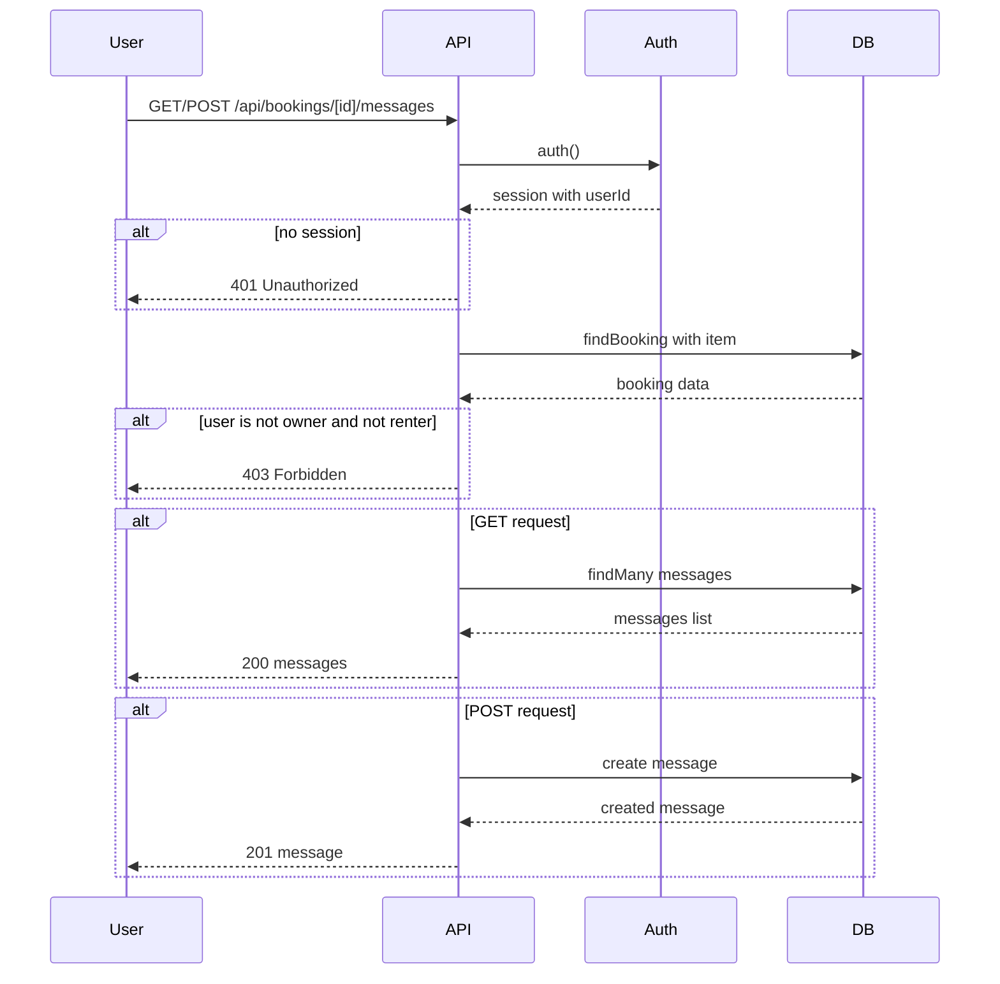

# План добавления чата для каждой брони

## Анализ текущей архитектуры

### Стек проекта
- **Фреймворк**: Next.js (App Router)
- **БД**: PostgreSQL + Prisma ORM
- **Аутентификация**: NextAuth.js (Credentials Provider)
- **Язык**: TypeScript

### Связанные модели (из [`prisma/schema.prisma`](prisma/schema.prisma:44))
- [`User`](prisma/schema.prisma:10) — пользователь (id, email, name и т.д.)
- [`Item`](prisma/schema.prisma:24) — вещь (ownerId, title, description и т.д.)
- [`Booking`](prisma/schema.prisma:44) — бронь (itemId, renterId, startDate, endDate, status и т.д.)

### Ключевые участники брони
- **Owner** (владелец вещи): `booking.item.ownerId`
- **Renter** (арендатор): `booking.renterId`

Оба участника должны иметь доступ к чату.

---

## 1. Изменения в схеме Prisma

### Новая модель `Message`

```prisma
model Message {
  id         String   @id @default(uuid())
  bookingId  String
  senderId   String
  content    String   @db.Text
  createdAt  DateTime @default(now())
  booking    Booking  @relation(fields: [bookingId], references: [id], onDelete: Cascade)
  sender     User     @relation(fields: [senderId], references: [id])

  @@index([bookingId, createdAt])
  @@map("messages")
}
```

### Изменения в `Booking`
Добавить отношение к сообщениям:

```prisma
model Booking {
  // ... существующие поля ...
  messages   Message[]
}
```

### Изменения в `User`
Добавить отношение к отправленным сообщениям:

```prisma
model User {
  // ... существующие поля ...
  sentMessages Message[] @relation("MessageSender")
}
```

### Обновлённая модель `Message` с точными именами отношений:

```prisma
model Message {
  id         String   @id @default(uuid())
  bookingId  String
  senderId   String
  content    String   @db.Text
  createdAt  DateTime @default(now())
  booking    Booking  @relation(fields: [bookingId], references: [id], onDelete: Cascade)
  sender     User     @relation("MessageSender", fields: [senderId], references: [id])

  @@index([bookingId, createdAt])
  @@map("messages")
}
```

### Команда миграции:
```bash
npx prisma migrate dev --name add_messages_table
```

---

## 2. API маршруты

### 2.1. Получение сообщений: `GET /api/bookings/[id]/messages`

**Файл**: `src/app/api/bookings/[id]/messages/route.ts`

**Логика**:
1. Проверка аутентификации через `await auth()`
2. Загрузка брони с `include: { item: true }`
3. Проверка доступа: текущий пользователь должен быть `owner` или `renter`
4. Загрузка всех сообщений для брони, отсортированных по `createdAt ASC`
5. Возврат JSON-массива сообщений

**Ответ**:
```typescript
interface MessageResponse {
  id: string;
  bookingId: string;
  senderId: string;
  senderName: string | null;
  content: string;
  createdAt: string; // ISO
}
```

**Важно**: Сообщения включают `senderName` для отображения отправителя на клиенте.

### 2.2. Отправка сообщения: `POST /api/bookings/[id]/messages`

**Файл**: `src/app/api/bookings/[id]/messages/route.ts` (в том же файле)

**Body**:
```typescript
{ content: string }
```

**Логика**:
1. Проверка аутентификации
2. Проверка доступа к брони (owner или renter)
3. Валидация `content` (не пустой, максимальная длина 2000 символов)
4. Создание сообщения через `prisma.message.create()`
5. Возврат созданного сообщения

**Ошибки**:
- `401` — не аутентифицирован
- `403` — нет доступа к брони
- `400` — пустое или слишком длинное сообщение
- `404` — бронь не найдена

### 2.3. Полная реализация `route.ts`

Структура файла по аналогии с [`src/app/api/bookings/[id]/status/route.ts`](src/app/api/bookings/[id]/status/route.ts:32):

```
GET  /api/bookings/[id]/messages  → получить список сообщений
POST /api/bookings/[id]/messages  → отправить сообщение
```

---

## 3. Страница детального просмотра брони `/bookings/[id]`

### 3.1. Новый маршрут

**Файл**: `src/app/bookings/[id]/page.tsx`

**Функционал**:
- Загрузка данных брони (item, renter, owner, статус)
- Отображение деталей брони (аналогично карточке в [`src/app/bookings/my/page.tsx`](src/app/bookings/my/page.tsx:77))
- Компонент чата внизу страницы

### 3.2. Доступ к странице
Только участники брони (owner вещи или renter):
```typescript
const isOwner = booking.item.ownerId === userId;
const isRenter = booking.renterId === userId;
if (!isOwner && !isRenter) redirect("/");
```

### 3.3. Загрузка данных
Серверный компонент загружает:
```typescript
const booking = await prisma.booking.findUnique({
  where: { id },
  include: {
    item: { include: { owner: true } },
    renter: true,
    messages: {
      include: { sender: true },
      orderBy: { createdAt: "asc" },
    },
  },
});
```

---

## 4. Компонент чата `BookingChat`

### 4.1. Файл
`src/components/BookingChat.tsx`

### 4.2. Тип
**Client Component** (`"use client"`) — требуется для состояния и polling.

### 4.3. Props
```typescript
interface BookingChatProps {
  bookingId: string;
  currentUserId: string;
  initialMessages: MessageWithSender[];
}
```

### 4.4. Функционал

#### Загрузка сообщений (polling)
- `useEffect` с `setInterval` каждые 3 секунды
- GET запрос к `/api/bookings/[bookingId]/messages`
- Сравнение количества сообщений для предотвращения лишних ререндеров
- Автоматическая прокрутка вниз при новых сообщениях

#### Отправка сообщения
- Форма с `textarea` и кнопкой отправки
- POST запрос к `/api/bookings/[bookingId]/messages`
- Очистка поля после отправки
- Блокировка кнопки во время отправки

#### Отображение сообщений
- Список сообщений с автопрокруткой
- Каждое сообщение содержит:
  - Имя отправителя (или "Вы")
  - Время отправки (формат: `HH:MM`)
  - Текст сообщения
- Сообщения текущего пользователя выровнены вправо (синий фон)
- Сообщения собеседника — влево (серый фон)

### 4.5. Состояние
```typescript
const [messages, setMessages] = useState<MessageWithSender[]>(initialMessages);
const [newMessage, setNewMessage] = useState("");
const [loading, setLoading] = useState(false);
const messagesEndRef = useRef<HTMLDivElement>(null);
```

### 4.6. Безопасность
- Без возможности редактирования/удаления сообщений
- Экранирование HTML (React автоматически экранирует текст)
- Максимальная длина сообщения проверяется на сервере

---

## 5. Архитектура доступа

### Диаграмма проверки доступа



### Правила доступа

| Роль | Доступ к чату | Отправка | Получение |
|------|--------------|----------|-----------|
| Owner вещи | Да | Да | Да |
| Renter (арендатор) | Да | Да | Да |
| Другой пользователь | Нет | Нет | Нет |
| Не аутентифицирован | Нет | Нет | Нет |

---

## 6. Пошаговый план реализации

### Шаг 1: Схема БД
1.1. Добавить модель `Message` в [`prisma/schema.prisma`](prisma/schema.prisma:1)
1.2. Добавить `messages Message[]` в модель `Booking`
1.3. Добавить `sentMessages Message[]` в модель `User`
1.4. Создать миграцию `npx prisma migrate dev --name add_messages_table`
1.5. Сгенерировать клиент `npx prisma generate`

### Шаг 2: API маршрут для сообщений
2.1. Создать `src/app/api/bookings/[id]/messages/route.ts`
2.2. Реализовать `GET` — получение сообщений с проверкой доступа
2.3. Реализовать `POST` — отправка сообщения с валидацией
2.4. Добавить функцию проверки доступа `canAccessBooking(userId, booking)`

### Шаг 3: Страница детального просмотра брони
3.1. Создать `src/app/bookings/[id]/page.tsx`
3.2. Реализовать загрузку данных брони (серверный компонент)
3.3. Добавить проверку доступа (перенаправление если нет прав)
3.4. Отрисовать детали брони (item, даты, статус, участники)
3.5. Встроить компонент `BookingChat`

### Шаг 4: Компонент чата
4.1. Создать `src/components/BookingChat.tsx`
4.2. Реализовать polling (GET каждые 3 сек)
4.3. Реализовать форму отправки (POST)
4.4. Реализовать отображение сообщений с временными метками
4.5. Добавить автопрокрутку вниз
4.6. Стилизовать сообщения (разные цвета для sender/другого)

### Шаг 5: Навигация
5.1. Добавить ссылки на `/bookings/[id]` в [`src/app/bookings/my/page.tsx`](src/app/bookings/my/page.tsx:77) (BookingCard)
5.2. Добавить ссылки в `src/app/bookings/received/page.tsx` (аналогично)

---

## 7. Структура новых файлов

```
prisma/
  schema.prisma                    # изменения

src/app/api/bookings/[id]/messages/
  route.ts                         # новый файл (GET + POST)

src/app/bookings/[id]/
  page.tsx                         # новый файл (детали брони + чат)

src/components/
  BookingChat.tsx                  # новый файл (client component)
```

---

## 8. Изменения в существующих файлах

| Файл | Изменение |
|------|-----------|
| [`prisma/schema.prisma`](prisma/schema.prisma:1) | + модель `Message`, + отношения в `Booking` и `User` |
| [`src/app/bookings/my/page.tsx`](src/app/bookings/my/page.tsx:77) | + Link на `/bookings/[id]` в `BookingCard` |
| `src/app/bookings/received/page.tsx` | + Link на `/bookings/[id]` (аналогично) |

---

## 9. Рассмотренные альтернативы

| Вариант | Решение | Почему выбрано |
|---------|---------|----------------|
| WebSocket vs Polling | Polling (3 сек) | Проще, нет внешних зависимостей, достаточно для чата брони |
| Реактивные Server Components | Client Component для чата | Polling требует client-side состояния |
| Редактирование сообщений | Без редактирования | Упрощение, требования задачи |
| Отдельная модель Conversation | Direct relation к Booking | Одна бронь = один чат, лишняя абстракция |
