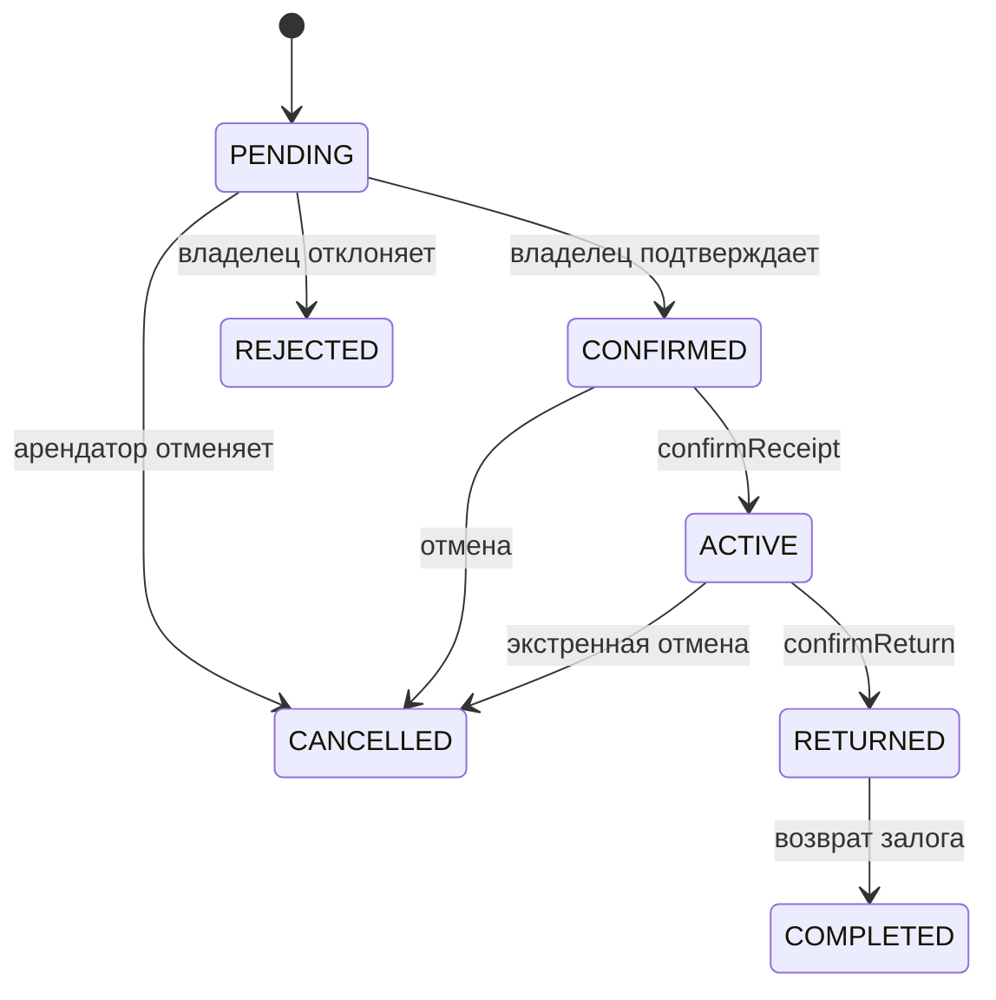

# План реализации жизненного цикла брони

## Резюме текущей структуры

### 1. [`prisma/schema.prisma`](prisma/schema.prisma) — Модель данных

**Модель [`Booking`](prisma/schema.prisma:45):**
- `id` (uuid), `itemId`, `renterId`, `startDate`, `endDate`, `totalAmount`, `status`, `createdAt`, `updatedAt`
- Связи: `item` (Item), `renter` (User), `review?` (Review), `messages[]` (Message)
- Индекс по `[itemId, startDate, endDate]`

**[`enum BookingStatus`](prisma/schema.prisma:91):**
```
PENDING, CONFIRMED, ACTIVE, COMPLETED, CANCELLED, REJECTED
```

**Модель [`Item`](prisma/schema.prisma:25):**
- Содержит `depositAmount` (Decimal), `pricePerDay` (Decimal)
- Связь с `owner` (User)

**Ключевое наблюдение:**
- Статус `RETURNED` **отсутствует** в текущем enum
- Поле `depositHeld` (boolean) **отсутствует** в модели Booking
- Нет полей для отслеживания переходов статусов (timestamps)

---

### 2. [`src/app/api/bookings/[id]/status/route.ts`](src/app/api/bookings/[id]/status/route.ts) — API смены статуса

**Текущая логика переходов ( [`STATUS_TRANSITIONS`](src/app/api/bookings/[id]/status/route.ts:11)):**

| Текущий статус | Владелец (owner) | Арендатор (renter) |
|---|---|---|
| `PENDING` | `CONFIRMED`, `REJECTED` | `CANCELLED` |
| `CONFIRMED` | `ACTIVE` | — |
| `ACTIVE` | `COMPLETED` | — |

**Ключевые наблюдения:**
- Переход `ACTIVE → COMPLETED` означает мгновенное завершение (без промежуточного `RETURNED`)
- Нет проверки `depositHeld` при завершении
- Роль определяется через `booking.item.ownerId === userId` и `booking.renterId === userId`
- Проверка переходов по ролям уже реализована

---

### 3. [`src/app/bookings/[id]/page.tsx`](src/app/bookings/[id]/page.tsx) — Страница детали брони

**Текущий функционал:**
- Загрузка брони с `item.owner` и `renter`
- Проверка доступа (`isRenter` или `isOwner`)
- Отображение: вещь, участники, даты, статус (badge), сумма
- Компонент чата [`BookingChat`](src/app/bookings/[id]/page.tsx:258)
- **Нет** таймлайна статусов
- **Нет** кнопок действий (смены статуса)
- **Нет** индикатора залога (`depositHeld`)

---

### 4. [`src/actions/booking-actions.ts`](src/actions/booking-actions.ts) — Серверные действия

- Только одно действие: [`updateBookingStatus()`](src/actions/booking-actions.ts:7)
- Делает fetch к API-эндпоинту `/api/bookings/[id]/status`
- Ревалидирует `/bookings/my` и `/bookings/received`

---

### 5. [`src/app/api/bookings/route.ts`](src/app/api/bookings/route.ts) — Создание брони

**Логика:**
- Транзакция с `FOR UPDATE` блокировкой Item
- Проверка пересечения с `CONFIRMED`/`ACTIVE` бронями
- Расчёт суммы: `дни * цена + залог + 10% комиссия`
- Создаёт бронь со статусом `PENDING`

---

## Целевая архитектура

### Новый жизненный цикл



### Изменения в схеме БД

#### 1. Обновление enum [`BookingStatus`](prisma/schema.prisma:91)
Добавить статус `RETURNED`.

#### 2. Новые поля модели [`Booking`](prisma/schema.prisma:45)
```prisma
depositHeld       Boolean       @default(false)
confirmedAt       DateTime?
activatedAt       DateTime?
returnedAt        DateTime?
completedAt       DateTime?
cancelledAt       DateTime?
```

---

## План реализации

### Этап 1: Обновление схемы БД

1.1. Добавить `RETURNED` в enum `BookingStatus`
1.2. Добавить поля в модель `Booking`:
  - `depositHeld Boolean @default(false)`
  - `confirmedAt DateTime?`
  - `activatedAt DateTime?`
  - `returnedAt DateTime?`
  - `completedAt DateTime?`
  - `cancelledAt DateTime?`
1.3. Создать и применить миграцию

### Этап 2: Обновление API переходов статусов

2.1. Обновить [`STATUS_TRANSITIONS`](src/app/api/bookings/[id]/status/route.ts:11):
  - `CONFIRMED`: owner → `ACTIVE`
  - `ACTIVE`: owner → `RETURNED`
  - `RETURNED`: owner → `COMPLETED` (с логикой возврата залога)
  - `CONFIRMED`: owner/renter → `CANCELLED`

2.2. При каждом переходе устанавливать соответствующий timestamp:
  - `CONFIRMED` → `confirmedAt`
  - `ACTIVE` → `activatedAt`, установить `depositHeld = true`
  - `RETURNED` → `returnedAt`
  - `COMPLETED` → `completedAt`, установить `depositHeld = false`
  - `CANCELLED` → `cancelledAt`, если `depositHeld = true` то сбросить

2.3. Создать специализированные серверные действия:
  - `confirmReceipt(bookingId)` → `PATCH` → статус `ACTIVE`
  - `confirmReturn(bookingId)` → `PATCH` → статус `RETURNED`
  - `cancelBooking(bookingId)` → `PATCH` → статус `CANCELLED`

### Этап 3: Страница детали брони с таймлайном

3.1. Добавить компонент `BookingTimeline` — визуальный таймлайн статусов:
  - Показывает все шаги: `PENDING → CONFIRMED → ACTIVE → RETURNED → COMPLETED`
  - Подсвечивает текущий статус
  - Отображает timestamps для пройденных шагов

3.2. Добавить панель действий (`BookingActions`) по ролям:

| Роль | Статус | Доступные действия |
|---|---|---|
| Owner | `PENDING` | Подтвердить, Отклонить |
| Renter | `PENDING` | Отменить |
| Owner | `CONFIRMED` | Подтвердить получение (confirmReceipt) |
| Owner | `ACTIVE` | Подтвердить возврат (confirmReturn) |
| Owner | `RETURNED` | Завершить (возврат залога) |
| Renter | `CONFIRMED` | Отменить |

3.3. Добавить индикатор залога (`depositHeld`):
  - Бейдж «Залог удержан» / «Залог возвращён»
  - Показать сумму залога из `item.depositAmount`

### Этап 4: Обновление серверных действий

4.1. Добавить в [`booking-actions.ts`](src/actions/booking-actions.ts):
  - `confirmReceipt(bookingId)`
  - `confirmReturn(bookingId)`
  - `cancelBooking(bookingId)`
4.2. Добавить revalidatePath для `/bookings/[id]`

### Этап 5: Тестирование и проверка

5.1. Проверить все переходы статусов
5.2. Проверить права доступа по ролям
5.3. Проверить установку timestamps
5.4. Проверить логику залога (`depositHeld`)

---

## Связанные файлы для изменений

| Файл | Изменения |
|---|---|
| [`prisma/schema.prisma`](prisma/schema.prisma) | + `RETURNED` в enum, + поля в `Booking` |
| [`src/app/api/bookings/[id]/status/route.ts`](src/app/api/bookings/[id]/status/route.ts) | Обновить transitions, добавить timestamps |
| [`src/actions/booking-actions.ts`](src/actions/booking-actions.ts) | + `confirmReceipt`, `confirmReturn`, `cancelBooking` |
| [`src/app/bookings/[id]/page.tsx`](src/app/bookings/[id]/page.tsx) | + `BookingTimeline`, + `BookingActions`, + индикатор залога |
| `src/components/BookingTimeline.tsx` | Новый компонент |
| `src/components/BookingActions.tsx` | Новый компонент |
