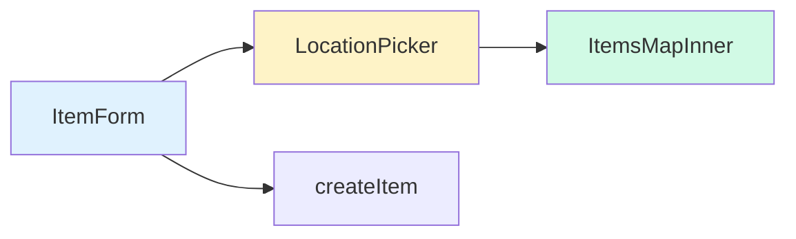
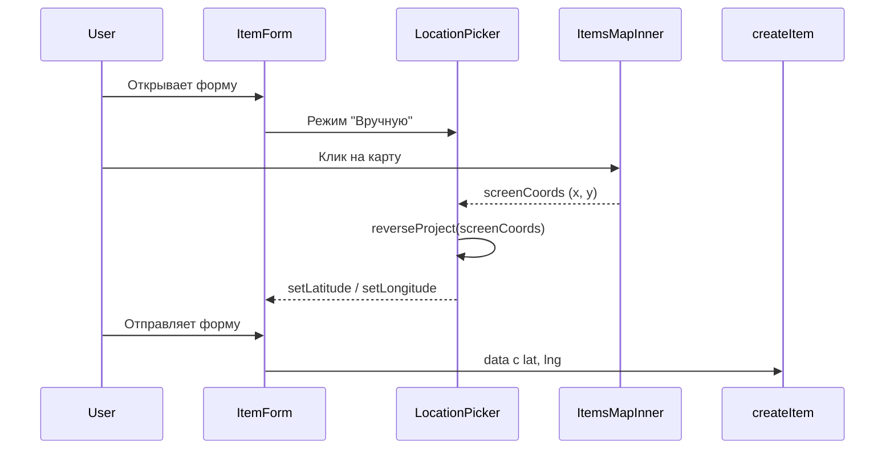

# План: Ручная установка геолокации при создании вещи

## Анализ текущего состояния

### Как работает сейчас

1. **[`ItemForm`](src/components/ItemForm.tsx)** при монтировании компонента вызывает `navigator.geolocation.getCurrentPosition()` для автоматического получения GPS-координат.
2. Координаты сохраняются в стейте `latitude` / `longitude` и передаются в [`createItem`](src/actions/item-actions.ts:56) как опциональные поля.
3. Пользователь **не видит** карту, **не может** изменить координаты — только наблюдает за статусом определения (`loading` → `success` / `error`).
4. В базе данных ([`Item`](prisma/schema.prisma:26)) поля `latitude` и `longitude` опциональны (`Float?`), миграции не нужны.
5. Компонент [`ItemsMapInner`](src/components/ItemsMapInner.tsx) — полнофункциональная кастомная карта на tile-проекции Меркатора с поддержкой перетаскивания (drag/pan), зума и маркеров. Использует OpenStreetMap тайлы.

### Ключевые технические детали карты

- [`ItemsMapInner`](src/components/ItemsMapInner.tsx:38) реализует Mercator-проекцию через функции [`latToY()`](src/components/ItemsMapInner.tsx:20) и [`lngToX()`](src/components/ItemsMapInner.tsx:25).
- Вычисляет пиксельные координаты центра карты: `offsetX`, `offsetY` с учётом `panOffset`.
- Преобразует гео-координаты в экранные пиксели: `mx = lngToX(lng) * earthPixels - offsetX`, `my = latToY(lat) * earthPixels - offsetY`.
- Обработка `onMouseDown` / `mousemove` / `mouseup` для drag/pan.
- Зум управляется через prop `zoom` (по умолчанию 5).
- Обёртка [`ItemsMap`](src/components/ItemsMap.tsx:19) использует `dynamic()` с `ssr: false`.

---

## Архитектура решения

### Подход

Создать новый компонент **LocationPicker**, который на базе [`ItemsMapInner`](src/components/ItemsMapInner.tsx) добавляет:

1. Возможность кликнуть на карту для установки маркера (координат).
2. Визуальный маркер выбранной позиции.
3. Управление зумом (+/- кнопки).
4. Обратное преобразование экранных координат → гео-координаты при клике.

Компонент [`ItemForm`](src/components/ItemForm.tsx) получает секцию геолокации с переключателем режимов:
- **"Авто (GPS)"** — текущее поведение.
- **"Вручную на карте"** — показывает `LocationPicker`.

### Диаграмма компонентов



### Диаграмма потока данных



---

## План реализации

### Шаг 1: Добавить функции обратного проецирования в ItemsMapInner

В компоненте [`ItemsMapInner`](src/components/ItemsMapInner.tsx) нужны функции для преобразования экранных координат обратно в гео-координаты. Это обратные операции к текущей проекции.

**Что добавить:**

- Функцию `yToLat(yFraction): number` — обратная к [`latToY()`](src/components/ItemsMapInner.tsx:20)
- Функцию `xToLng(xFraction): number` — обратная к [`lngToX()`](src/components/ItemsMapInner.tsx:25)
- Метод `screenToGeo(screenX: number, screenY: number): { lat: number; lng: number }` — принимает экранные пиксельные координаты внутри контейнера и возвращает гео-координаты
- Prop `onMapClick?: (lat: number, lng: number) => void` — колбэк при клике на карту
- При наличии `onMapClick` отключать drag/pan (или использовать модификатор, например Ctrl+клик для выбора, а обычный клик для перетаскивания)

**Детали вычислений:**

```
// В itemsMapInner внутри блока useMemo уже вычисляются:
// earthPixels, offsetX, offsetY, centerX, centerY, containerCenterX, containerCenterY

// Обратное преобразование:
// worldX = screenX + offsetX
// worldY = screenY + offsetY
// xFraction = worldX / earthPixels
// yFraction = worldY / earthPixels
// lng = xFraction * 360 - 180
// lat = обратная Меркатор-проекция от yFraction
```

### Шаг 2: Создать компонент LocationPicker

**Файл:** `src/components/LocationPicker.tsx`

**Props:**

| Имя | Тип | Описание |
|-----|-----|----------|
| `selectedLat` | `number \| undefined` | Текущая широта |
| `selectedLng` | `number \| undefined` | Текущая долгота |
| `onSelect` | `(lat: number, lng: number) => void` | Колбэк при выборе координат |
| `center` | `[number, number]` | Центр карты (по умолчанию Москва или текущая локация) |
| `zoom` | `number` | Начальный зум |

**Функционал:**

- Рендерит [`ItemsMap`](src/components/ItemsMap.tsx) с props `onMapClick` и одним маркером (выбранную позицию)
- Показывает кнопки зума (+/-) поверх карты
- Отображает выбранные координаты текстом под картой
- Если `selectedLat` / `selectedLng` заданы — показывает маркер в этой точке
- При клике на карту вызывает `onSelect(lat, lng)`
- Если переданы `center` из GPS — центрирует карту на этой позиции

### Шаг 3: Создать серверный action для получения адреса по координатам (опционально)

Для лучшего UX можно добавить обратное геокодирование (Nominatim API), чтобы показывать примерный адрес. Но это опционально — основной функционал работает без этого.

### Шаг 4: Обновить ItemForm

**Файл:** [`src/components/ItemForm.tsx`](src/components/ItemForm.tsx)

**Изменения:**

1. Добавить стейт `locationMode` со значениями `'gps' | 'manual'` (по умолчанию `'gps'`).
2. Добавить стейт `manualLatitude` и `manualLongitude` для ручного выбора.
3. В секции геолокации:
   - Показать переключатель режимов (radio buttons или tabs).
   - При режиме `'gps'` — текущее поведение (автоматическое определение + статус).
   - При режиме `'manual'` — рендерить `<LocationPicker>`.
   - Когда пользователь выбирает место на карте — обновлять `manualLatitude` / `manualLongitude`.
   - Показывать выбранные координаты текстом.
4. В `handleSubmit` использовать финальные координаты:
   - Если режим `'gps'` → `latitude`, `longitude` (из GPS).
   - Если режим `'manual'` → `manualLatitude`, `manualLongitude`.

**UI секции геолокации:**

```
┌─────────────────────────────────────────────┐
│  Геолокация                                 │
│                                             │
│  (•) Авто (GPS)    ( ) Вручную на карте     │
│                                             │
│  ✓ Локация определена: 55.751244, 37.618423 │
└─────────────────────────────────────────────┘

Или:

┌─────────────────────────────────────────────┐
│  Геолокация                                 │
│                                             │
│  ( ) Авто (GPS)    (•) Вручную на карте     │
│                                             │
│  ┌─────────────────────────────────────┐    │
│  │         [ Карта ]                   │    │
│  │        +       -  (зум)             │    │
│  │         [ Карта ]                   │    │
│  └─────────────────────────────────────┘    │
│                                             │
│  📍 Выбрано: 55.751244, 37.618423          │
└─────────────────────────────────────────────┘
```

### Шаг 5: Обновить ItemsMap обёртку

**Файл:** [`src/components/ItemsMap.tsx`](src/components/ItemsMap.tsx)

Добавить в интерфейс `ItemsMapProps`:

- `onMapClick?: (lat: number, lng: number) => void`
- Передавать эти пропсы в `<MapComponent>`

### Шаг 6: Обновить ItemsMapInner

**Файл:** [`src/components/ItemsMapInner.tsx`](src/components/ItemsMapInner.tsx)

Подробные изменения:

1. **Добавить reverse-projection функции (до компонента):**

```typescript
function yToLat(y: number): number {
  const latRad = Math.atan(Math.sinh(Math.PI * (1 - 2 * y)));
  return (latRad * 180) / Math.PI;
}

function xToLng(x: number): number {
  return x * 360 - 180;
}
```

2. **Добавить prop `onMapClick` в интерфейс:**

```typescript
interface ItemsMapInnerProps {
  items: MapItem[];
  center?: [number, number];
  zoom?: number;
  onMapClick?: (lat: number, lng: number) => void;
}
```

3. **Добавить handler клика:**

- Внутри компонента вычислять `screenToGeo` используя те же переменные, что и в `useMemo` для тайлов.
- Поскольку вычисления находятся внутри `useMemo`, вынести общие параметры (`earthPixels`, `offsetX`, `offsetY`, `containerSize`) в отдельный `useMemo` или вычислить их в handler клика.
- При клике на контейнер карты (если `onMapClick` задан):
  - Получить координаты клика относительно контейнера (`getBoundingClientRect`).
  - Преобразовать в geo-координаты.
  - Вызвать `onMapClick(lat, lng)`.
- Если `onMapClick` задан, отключить drag/pan (или сделать drag по правому клику / с модификатором).

4. **Добавить prop `selectedLocation` для отображения маркера выбора:**

```typescript
interface ItemsMapInnerProps {
  // ...
  selectedLocation?: { lat: number; lng: number };
}
```

- Если `selectedLocation` задан — добавить дополнительный маркер (зелёный, чтобы отличить от синих маркеров вещей).
- Позиционировать аналогично существующим маркерам.

---

## Резюме изменений по файлам

| Файл | Изменения |
|------|-----------|
| `src/components/ItemsMapInner.tsx` | Добавить `onMapClick`, `selectedLocation`, reverse-projection функции, handler клика, отключение drag при клике |
| `src/components/ItemsMap.tsx` | Добавить `onMapClick`, `selectedLocation` в props и передавать вниз |
| `src/components/LocationPicker.tsx` | **Новый файл** — компонент выбора локации с картой, зумом и маркером |
| `src/components/ItemForm.tsx` | Добавить переключатель режима GPS/Manual, рендер LocationPicker, использовать координаты из выбранного режима |
| `src/actions/item-actions.ts` | Без изменений |
| `prisma/schema.prisma` | Без изменений |

---

## Последовательность реализации

1. **ItemsMapInner** — добавить reverse-projection и props для интерактивности.
2. **ItemsMap** — расширить интерфейс обёртки.
3. **LocationPicker** — создать новый компонент.
4. **ItemForm** — интегрировать LocationPicker с переключателем режимов.
