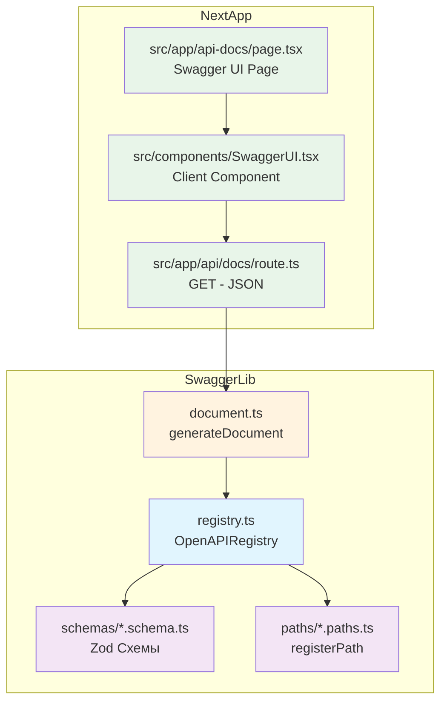

# План добавления Swagger/OpenAPI документации

## Общее описание

Добавление полной Swagger/OpenAPI документации для всех API роутов проекта `reserving_items` с использованием Zod-базированного подхода.

## Выбор библиотеки

### Выбранная библиотека: `@asteasolutions/zod-to-openapi` + `swagger-ui-react`

**Обоснование:**
- **`@asteasolutions/zod-to-openapi`** — генерирует OpenAPI документ из Zod схем, обеспечивая единство валидации и документации
- **`swagger-ui-react`** — React компонент для отображения Swagger UI, идеально подходит для Next.js App Router
- Проект не использует Zod в настоящее время, поэтому потребуется добавление валидации на основе Zod

**Альтернативы, которые были рассмотрены:**
- `next-swagger-doc` — устаревшая библиотека, не поддерживает App Router полностью
- `@anatine/zod-openapi` — аналогичный пакет, но `@asteasolutions/zod-to-openapi` более активно поддерживается

## Структура файлов

```
src/
├── app/
│   ├── api/
│   │   └── docs/
│   │       └── route.ts          # API роут для OpenAPI JSON документа
│   └── api-docs/
│       └── page.tsx              # Страница Swagger UI (Client Component)
├── lib/
│   └── swagger/
│       ├── registry.ts           # OpenAPIRegistry и инициализация
│       ├── schemas/              # Zod схемы для компонентов
│       │   ├── user.schema.ts
│       │   ├── item.schema.ts
│       │   ├── booking.schema.ts
│       │   ├── message.schema.ts
│       │   └── review.schema.ts
│       ├── paths/                # Регистрация API путей
│       │   ├── auth.paths.ts
│       │   ├── bookings.paths.ts
│       │   ├── messages.paths.ts
│       │   ├── status.paths.ts
│       │   └── reviews.paths.ts
│       └── document.ts           # Генерация финального документа
└── components/
    └── SwaggerUI.tsx             # Обёртка для swagger-ui-react
```

## Зависимости

### Production зависимости
```json
{
  "zod": "^3.24.2",
  "@asteasolutions/zod-to-openapi": "^8.5.0",
  "swagger-ui-react": "^5.21.0"
}
```

### Dev зависимости (опционально)
```json
{
  "@types/swagger-ui-react": "^4.18.3"
}
```

## Подход к документированию

### 1. Создание Zod схем для всех моделей

Каждая Prisma модель будет представлена Zod схемой с OpenAPI метаданными:

```typescript
// src/lib/swagger/schemas/user.schema.ts
import { z } from 'zod';

export const UserSchema = z.object({
  id: z.string().uuid().openapi({
    example: '123e4567-e89b-12d3-a456-426614174000',
    description: 'UUID пользователя',
  }),
  email: z.string().email().openapi({
    example: 'user@example.com',
    description: 'Email пользователя',
  }),
  name: z.string().nullable().openapi({
    example: 'Иван Иванов',
    description: 'Имя пользователя',
  }),
  avatarUrl: z.string().url().nullable().openapi({
    description: 'URL аватара',
  }),
  isVerified: z.boolean().openapi({
    description: 'Подтверждён ли email',
  }),
  createdAt: z.string().datetime().openapi({
    description: 'Дата создания',
  }),
}).openapi('User');
```

### 2. Регистрация путей через OpenAPIRegistry

Каждый API роут документируется через `registry.registerPath()`:

```typescript
// src/lib/swagger/paths/bookings.paths.ts
import { z } from 'zod';
import { registry } from '@/lib/swagger/registry';
import { BookingSchema } from '@/lib/swagger/schemas/booking.schema';

// Схема запроса для создания бронирования
const CreateBookingBodySchema = z.object({
  itemId: z.string().uuid().openapi({
    description: 'ID предмета для бронирования',
    example: '123e4567-e89b-12d3-a456-426614174000',
  }),
  startDate: z.string().datetime().openapi({
    description: 'Дата начала бронирования',
  }),
  endDate: z.string().datetime().openapi({
    description: 'Дата окончания бронирования',
  }),
});

registry.registerPath({
  method: 'post',
  path: '/api/bookings',
  summary: 'Создать бронирование',
  description: 'Создаёт новое бронирование предмета. Требуется аутентификация.',
  security: [{ bearerAuth: [] }],
  request: {
    body: {
      content: {
        'application/json': {
          schema: CreateBookingBodySchema,
        },
      },
    },
  },
  responses: {
    201: {
      description: 'Бронирование создано',
      content: {
        'application/json': {
          schema: BookingSchema,
        },
      },
    },
    400: { description: 'Ошибка валидации' },
    401: { description: 'Требуется аутентификация' },
    409: { description: 'Период уже забронирован' },
  },
});
```

### 3. Генерация документа

```typescript
// src/lib/swagger/document.ts
import { OpenApiGeneratorV31 } from '@asteasolutions/zod-to-openapi';
import { registry } from './registry';

// Импортируем все пути для регистрации
import './paths/auth.paths';
import './paths/bookings.paths';
import './paths/messages.paths';
import './paths/status.paths';
import './paths/reviews.paths';

export function generateOpenAPIDocument() {
  const generator = new OpenApiGeneratorV31(registry.definitions, {
    unionPreferredType: 'oneOf',
    sortComponents: 'alphabetically',
  });

  return generator.generateDocument({
    openapi: '3.1.0',
    info: {
      title: 'Reserving Items API',
      version: '1.0.0',
      description: 'API для платформы аренды вещей',
    },
    servers: [
      { url: '/', description: 'Локальный сервер' },
    ],
    components: {
      securitySchemes: {
        bearerAuth: {
          type: 'http',
          scheme: 'bearer',
          bearerFormat: 'JWT',
        },
      },
    },
  });
}
```

## API Роут для OpenAPI JSON

### `src/app/api/docs/route.ts`

```typescript
import { NextResponse } from 'next/server';
import { generateOpenAPIDocument } from '@/lib/swagger/document';

export async function GET() {
  const document = generateOpenAPIDocument();
  return NextResponse.json(document);
}
```

Этот роут возвращает OpenAPI документ в формате JSON по адресу `/api/docs`.

## Страница Swagger UI

### `src/app/api-docs/page.tsx`

Client Component, который рендерит Swagger UI:

```typescript
'use client';

import dynamic from 'next/dynamic';

const SwaggerUI = dynamic(() => import('@/components/SwaggerUI'), {
  ssr: false,
});

export default function ApiDocsPage() {
  return <SwaggerUI />;
}
```

### `src/components/SwaggerUI.tsx`

```typescript
'use client';

import SwaggerUI from 'swagger-ui-react';
import 'swagger-ui-react/swagger-ui.css';

export default function SwaggerUIComponent() {
  return (
    <SwaggerUI
      url="/api/docs"
      persistAuthorization={true}
      displayOperationId={true}
      displayRequestDuration={true}
      filter={true}
      tryItOutEnabled={true}
      defaultModelsExpandDepth={-1}
    />
  );
}
```

## Список документируемых эндпоинтов

| Метод | Путь | Описание |
|-------|------|----------|
| GET | `/api/auth/[...nextauth]` | NextAuth callback (Callback URL) |
| POST | `/api/auth/[...nextauth]` | NextAuth callback (Callback URL) |
| GET | `/api/bookings` | Список всех бронирований |
| POST | `/api/bookings` | Создание бронирования |
| GET | `/api/bookings/my` | Мои бронирования (как renter) |
| GET | `/api/bookings/received` | Полученные бронирования (как owner) |
| GET | `/api/bookings/item/[id]` | Бронирования для конкретного предмета |
| POST | `/api/bookings/[id]/messages` | Отправить сообщение в чат |
| GET | `/api/bookings/[id]/messages` | Получить сообщения чата |
| PATCH | `/api/bookings/[id]/status` | Сменить статус бронирования |
| GET | `/api/reviews` | Список отзывов |
| POST | `/api/reviews` | Создание отзыва |

## Пошаговый план реализации

### Шаг 1: Установка зависимостей

```bash
npm install zod @asteasolutions/zod-to-openapi swagger-ui-react
npm install -D @types/swagger-ui-react
```

### Шаг 2: Инициализация OpenAPI registry

Создать `src/lib/swagger/registry.ts` с инициализацией `extendZodWithOpenApi` и `OpenAPIRegistry`.

### Шаг 3: Создание Zod схем

Создать схемы для всех моделей в `src/lib/swagger/schemas/`:
- `user.schema.ts`
- `item.schema.ts`
- `booking.schema.ts`
- `message.schema.ts`
- `review.schema.ts`

### Шаг 4: Регистрация API путей

Создать файлы путей в `src/lib/swagger/paths/`:
- `auth.paths.ts` — документация NextAuth эндпоинтов
- `bookings.paths.ts` — CRUD для бронирований
- `messages.paths.ts` — чат бронирований
- `status.paths.ts` — смена статуса
- `reviews.paths.ts` — отзывы

### Шаг 5: Генерация документа

Создать `src/lib/swagger/document.ts` с функцией `generateOpenAPIDocument()`.

### Шаг 6: Создание API роута для OpenAPI JSON

Создать `src/app/api/docs/route.ts`.

### Шаг 7: Создание Swagger UI страницы

Создать:
- `src/components/SwaggerUI.tsx` — компонент-обёртка
- `src/app/api-docs/page.tsx` — страница с документацией

### Шаг 8: Проверка и тестирование

Проверить:
1. `/api/docs` возвращает валидный JSON документ
2. `/api-docs` корректно отображает Swagger UI
3. Все эндпоинты документированы с правильными схемами

## Диаграмма архитектуры



## Важные замечания

1. **NextAuth документация**: NextAuth предоставляет собственный OpenAPI callback URL, который можно включить в документацию.

2. **Динамические роуты**: Путь `[id]` в App Router соответствует `{id}` в OpenAPI спецификации.

3. **Типизация**: Все Zod схемы автоматически предоставляют TypeScript типы через `z.infer<>`.

4. **SSR для SwaggerUI**: Компонент `swagger-ui-react` требует клиентского рендеринга (используется `dynamic` с `ssr: false`).

5. **Безопасность**: В продакшене рекомендуется добавить проверку окружения для доступа к Swagger UI.
